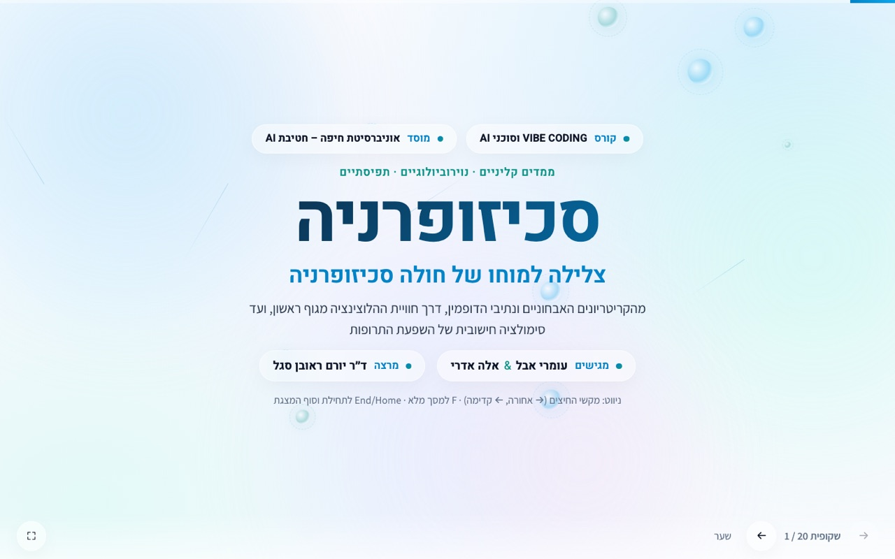
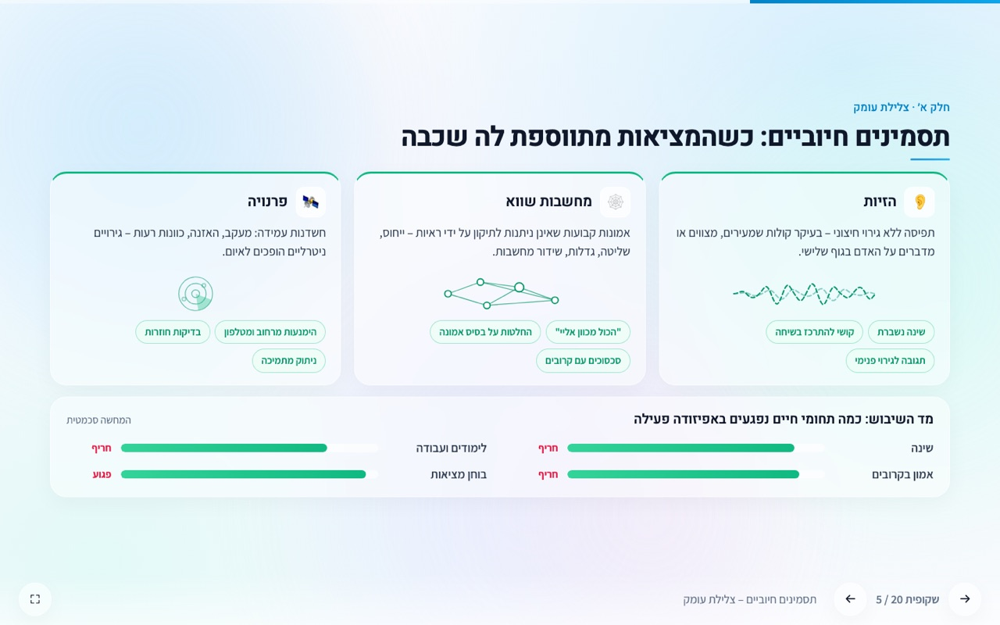
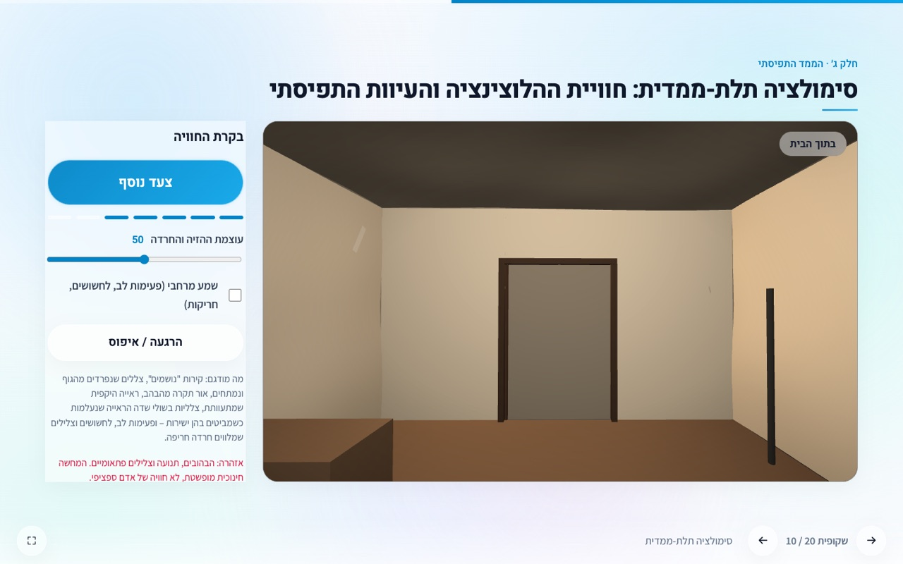
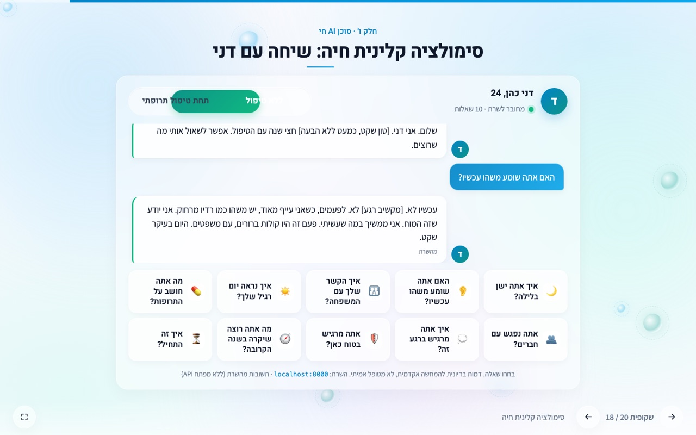
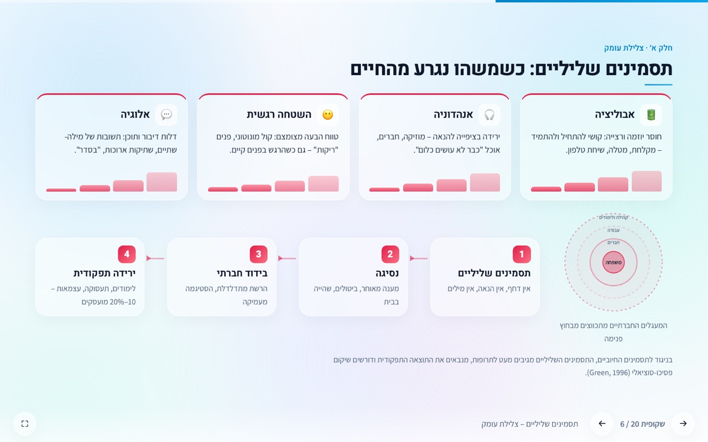
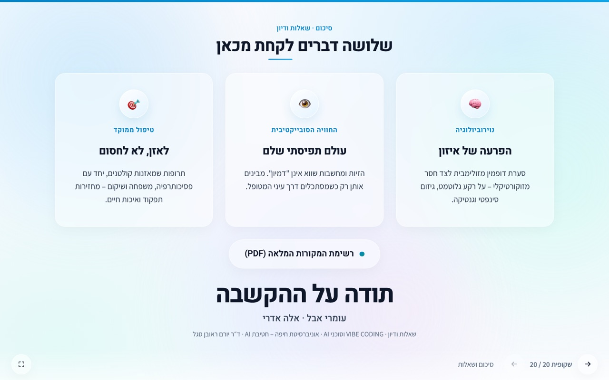

# Schizophrenia Vibe Project · מבוא לסכיזופרניה: פסיכוביולוגיה, תפיסה וטכנולוגיה

[](https://github.com/OmriAbel6/schizophrenia-vibe-project)

מצגת אקדמית אינטראקטיבית (אפליקציית עמוד יחיד, 20 שקופיות, עברית RTL) על סכיזופרניה – הממד הקליני,
הנוירוביולוגי והתפיסתי – בליווי סימולציה תלת-ממדית של חוויית ההלוצינציה, ו**סוכן AI חי** (שרת FastAPI + LLM)
המדמה מטופל סכיזופרני בשני מצבים קליניים, שאיתו הקהל משוחח ישירות מתוך המצגת.

## פרטי הפרויקט

| שדה | פרטים |
|---|---|
| **שם הפרויקט** | Schizophrenia: Clinical, Neurobiological, and Perceptual Dimensions |
| **מאגר** | https://github.com/OmriAbel6/schizophrenia-vibe-project |
| **מגישים** | עומרי אבל (`@OmriAbel6`) ואלה אדרי |
| **מרצה** | ד״ר יורם ראובן סגל |
| **קורס / מוסד** | VIBE CODING וסוכני AI · אוניברסיטת חיפה – חטיבת AI · תשפ"ז |
| **כלי AI** | Claude Code (Claude Fable 5.1) – יומני הפרומפטים ב-[`prompts/`](prompts/) |
| **מסמך דרישות** | [`PRD.md`](PRD.md) |

## צילומי מסך

| ממשק המצגת (Liquid Glass) | צלילת עומק – תסמינים חיוביים |
|---|---|
|  |  |

| רכיב ה-3D – חוויה מגוף ראשון (Three.js) | הפלט האינטראקטיבי של הפייתון – סוכן המטופל |
|---|---|
|  |  |

| צלילת עומק – תסמינים שליליים | שקופית הסיום |
|---|---|
|  |  |

הצילומים נלכדו ב-Chrome headless ברזולוציית 1440×900 מהמצגת כפי שהיא מוגשת על ידי שרת ה-FastAPI (`docs/screenshots/`).

## מבנה המאגר

```
schizophrenia-vibe-project/
├── web/                         המצגת
│   ├── index.html               20 שקופיות, lang="he" dir="rtl"
│   ├── style.css                מערכת עיצוב רפואית/פארמה (אלבסטר, נייבי, קובלט, טיל), Rubik + Assistant, בידוד bidi
│   ├── app.js                   ניווט, סצנת POV (Three.js), אודיו מרחבי, ויזואליזציות Neuro-Sim, מיקרו-אנימציות וגשר המוח
│   ├── dialogue.js              עותק של מאגר המשבצות לעבודה ללא שרת (נוצר ע"י dialogue.py)
│   └── references.pdf           רשימת המקורות האקדמיים (נוצר ע"י generate_references_pdf.py)
├── python/                      שרת הסוכן
│   ├── main.py                    שרת FastAPI: POST /api/chat, GET /api/questions, /api/dialogue, /api/health, /api/neuro-sim, הגשת web/
│   ├── dialogue.py                מאגר משבצות השיח (10 שאלות × 2 מצבים × 2 גרסאות) + יצוא ל-web/dialogue.js
│   ├── schizophrenia_analysis.py  מודל Neuro-Sim (ספרייה) – מעגן את הפרסונות ומוגש ב-/api/neuro-sim
│   ├── generate_references_pdf.py כותב PDF של המקורות בספרייה הסטנדרטית בלבד
│   └── requirements.txt           fastapi · uvicorn · pydantic · openai
├── docs/screenshots/            צילומי מסך של המצגת, רכיב ה-3D והסוכן (מוטמעים ב-README)
├── prompts/                     יומני האינטראקציה עם ה-AI
│   ├── 01_project_scaffolding.md
│   ├── 02_frontend_development.md
│   ├── 03_python_orchestrator.md
│   ├── 04_submission_and_git.md
│   ├── 05_neuro_sim_and_ux_overhaul.md
│   ├── 06_pharma_design_and_structural_refinement.md
│   ├── 07_layout_infographics_and_brain_gif.md
│   ├── 08_liquid_glass_and_final_polish.md
│   ├── 09_live_ai_patient_agent.md
│   ├── 10_tile_based_agent_and_20_slides.md
│   └── 11_red_team_qa_audit.md
├── PRD.md                       מסמך דרישות המוצר
└── README.md
```

## הוראות הרצה

### דרישות מוקדמות
- Python 3.9 ומעלה.
- דפדפן מודרני. סצנת ה-3D נטענת מ-CDN (`three.js r128`) ולכן דורשת חיבור לאינטרנט; ללא חיבור מוצג גיבוי
  דו-ממדי.
- **לא נדרש מפתח API**: משבצות השאלה נענות ממאגר מובנה בשרת (`dialogue.py`), ואותו מאגר קיים גם בדפדפן
  (`web/dialogue.js`) – כך ההדגמה עובדת גם בלי שרת ובלי אינטרנט. מפתח OpenAI (`OPENAI_API_KEY`) נדרש רק
  לשיחה חופשית דרך ה-API.

### 1. הפעלת שרת הסוכן (FastAPI)
```bash
git clone https://github.com/OmriAbel6/schizophrenia-vibe-project.git
cd schizophrenia-vibe-project/python
python3 -m venv .venv && .venv/bin/pip install -r requirements.txt
export OPENAI_API_KEY=sk-...                 # אופציונלי; אפשר גם OPENAI_MODEL (ברירת מחדל gpt-4o-mini)
.venv/bin/uvicorn main:app --reload --port 8000
```
נקודות קצה: `POST /api/chat` (גוף: `{question_id, clinical_state: "untreated"|"treated"}`; או `message` לשיחה
חופשית), `GET /api/questions`, `GET /api/dialogue`, `GET /api/health`, `GET /api/neuro-sim`. השרת גם מגיש את
`web/` בכתובת http://localhost:8000.

```bash
python3 dialogue.py --export ../web/dialogue.js   # לעדכן את עותק הדפדפן אחרי שינוי במאגר
```

### 2. הצגת המצגת
לפתוח http://localhost:8000 (מומלץ – מצגת ושרת באותו מקור), או לפתוח את `web/index.html` ישירות מהדיסק –
שקופית הסימולציה תפנה ל-http://localhost:8000, ואם השרת אינו זמין תענה מהמאגר המקומי `dialogue.js` באופן זהה.

```bash
python3 generate_references_pdf.py   # יצירה מחדש של web/references.pdf (ספרייה סטנדרטית בלבד)
```

### ניווט
| פעולה | מקש |
|---|---|
| קדימה | ← / רווח / PageDown |
| אחורה | → / PageUp |
| תחילה / סוף | Home / End |
| מסך מלא | F |
| קפיצה לשקופית | `index.html#8` |

## מתווה השקופיות

| # | כותרת | תוכן עיקרי | רכיב אינטראקטיבי |
|---|---|---|---|
| 1 | שער | "סכיזופרניה: צלילה למוחו של חולה סכיזופרניה", תגי קורס ומוסד, מגישים ומרצה | – |
| 2 | הגדרה קלינית ואפידמיולוגיה | הגדרה, שכיחות, גיל הופעה, תורשתיות, גורמי סיכון | אריחי נתונים |
| 3 | קריטריונים אבחוניים DSM-5-TR | קריטריונים A–F, ביטול תת-הסוגים | – |
| 4 | תסמינים חיוביים ושליליים | הזיות, מחשבות שווא, אי-ארגון / חמשת ה-A, ראשוני מול משני | – |
| 5 | תסמינים חיוביים – צלילת עומק | הזיות, מחשבות שווא, פרנויה – כיצד הן משבשות תפיסה וחיי יום-יום | אינפוגרפיקת זכוכית: שלושה כרטיסים + מד שיבוש תחומי חיים |
| 6 | תסמינים שליליים – צלילת עומק | אבוליציה, אנהדוניה, השטחה רגשית, אלוגיה – המפל לבידוד וירידה תפקודית | כרטיסים מנוגדים + מעגלים חברתיים מתכווצים + שרשרת המפל |
| 7 | השערת הדופמין | גרסאות I–III, סליינס חריג | תרשים זרימה אופקי אינטראקטיבי (4 שלבים, תובנה קלינית בריחוף/לחיצה) |
| 8 | גלוטמט | תת-תפקוד NMDA, PCP/קטמין, אינטרנוירוני PV, GWAS | – |
| 9 | הקורטקס הפרה-פרונטלי | היפו-פרונטליות, DLPFC, גיזום סינפטי, C4A | – |
| 10 | סימולציה תלת-ממדית | חוויה מגוף ראשון: יציאה מדלת הבית אל הרחוב – קירות נושמים, צללים נפרדים, אור מהבהב, צלליות היקפיות, וינייטה ואברציה כרומטית; פעימות לב, לחשושים, חריקות וצלצול | Three.js POV + Web Audio, כפתור צעד, מחוון עוצמה, שמע מרחבי, איפוס |
| 11 | ליקויים קוגניטיביים | 7 תחומי MATRICS, קוגניציה חברתית, ניבוי תפקוד | – |
| 12 | תסמינים אפקטיביים | דיכאון, חרדה, פרדוקס הרגש, סיכון אובדני | אריחי נתונים |
| 13 | ירידה תפקודית | תעסוקה, מגורים, DUP, תחלואה גופנית | – |
| 14 | מהלך ופרוגנוזה | פרמורבידי → פרודרום → אפיזודה → הישנויות, מנבאים | ציר זמן |
| 15 | טיפול תרופתי | FGA מול SGA – מנגנון, יעילות, תופעות לוואי; CATIE, LAI, משך טיפול | שני כרטיסי דור + שלוש מסקנות |
| 16 | פסיכותרפיה ושיקום | CBTp, משפחה, CRT, IPS, מיומנויות, התערבות מוקדמת | – |
| 17 | בריאות דיגיטלית | AVATAR, gameChange, EMA, CrossCheck, אתגרים | – |
| 18 | סימולציה קלינית חיה | ראיון עם הסוכן המדמה את דני בשני מצבים | משבצות שאלה Liquid Glass, מתג מצב, הודעות RTL, ספינר זכוכית, FastAPI + גיבוי מקומי זהה |
| 19 | אתיקה ועתיד | סטיגמה, הסכמה, כפייה, הוגנות אלגוריתמית, טיפולים חדשים | במעבר ל-20: אנימציית SVG/CSS של מוח פועם ורועד (ויזואליה בלבד, ללא טקסט) |
| 20 | סיכום ושאלות | שלושה כרטיסי זכוכית (נוירוביולוגיה, חוויה, טיפול), "תודה על ההקשבה" | כפתור גלולה להורדת `references.pdf` |

## רכיב הפייתון: סוכן מטופל מבוסס משבצות שיח (python/main.py + dialogue.py)

שרת FastAPI קל המריץ **סוכן ראיון** המגלם דמות בדיונית – דני כהן, בן 24 – בשני מצבים קליניים. הקהל בוחר
משבצת שאלה (שינה, קולות, משפחה, יום רגיל, תרופות, חברים, הרגשה, ביטחון, עתיד, איך זה התחיל), והשרת מחזיר
תשובה שתלויה גם בשאלה וגם במצב:

| מצב | תיאור הפרסונה |
|---|---|
| `untreated` – ללא טיפול | אפיזודה פסיכוטית פעילה: הזיות שמיעה (קולות בגוף שלישי), מחשבות רדיפה וייחוס, התרופפות אסוציאציות מתונה, חרדה גבוהה, תובנה מועטה |
| `treated` – תחת טיפול תרופתי | שישה חודשים של אנטי-פסיכוטי מדור שני: קוהרנטי ובוחן מציאות, תובנה על ההזיות שהיו – לצד תסמינים שליליים ברורים: אפקט שטוח, אבוליציה, דלות דיבור ונסיגה חברתית; תופעות לוואי (עייפות, עלייה במשקל) |

- **משבצות**: `dialogue.py` מחזיק 10 שאלות × 2 מצבים × 2 גרסאות (40 תשובות); לחיצות חוזרות מקבלות את
  הגרסה הבאה. אותו מאגר מיוצא ל-`web/dialogue.js` כגיבוי מלא ללא שרת.
- **שיחה חופשית (אופציונלי)**: `message` במקום `question_id` – OpenAI Chat Completions דרך `OPENAI_API_KEY`
  (`OPENAI_MODEL`, ברירת מחדל `gpt-4o-mini`), ובלי מפתח תשובת הדגמה. הממשק במצגת אינו מציג שדה טקסט חופשי.
- **בטיחות בשני הפרומפטים**: יציאה מהדמות והפניה לער"ן 1201 / 101 במקרה של מצוקה או אובדנות; ללא ייעוץ
  רפואי או מינונים; הצגה מכבדת ולא סנסציונית. הדמות אינה מטופל אמיתי.
- **עיגון במודל Neuro-Sim**: מספרי האות הדופמינרגי והתסמינים של המצב (מ-`schizophrenia_analysis.py`)
  מצורפים לפרומפט כרקע פנימי, והמודל כולו זמין ב-`GET /api/neuro-sim`.
- **CORS** פתוח כדי שהמצגת תוכל לפנות לשרת גם כשהיא נפתחת מהדיסק.

## אימות

| בדיקה | שיטה | תוצאה |
|---|---|---|
| קומפילציה והרצה של פייתון, אורך שורות PEP 8 | `py_compile`, סריקת אורך תווים (≤ 88) | עבר |
| תחביר JavaScript | `node --check web/app.js` | עבר |
| פלטת התרשימים | מאמת צבעים (עיוורון צבעים, ניגודיות) על `#0f172a` ו-`#1e293b` | 6/6 בדיקות עברו |
| פריסת השקופיות | צילומי מסך ב-Chrome headless, 1440×900 | עבר |
| שרת הסוכן | `uvicorn` ב-venv, `curl` ל-/api/questions ו-/api/chat עם `question_id` בשני המצבים (תשובות שונות ומתחלפות), 404 על משבצת לא קיימת, 422 על בקשה ריקה, CORS, מצב LLM עם מפתח לא תקין → 502 | עבר |
| סצנת POV (WebGL) | Chrome headless עם SwiftShader, הפעלה אוטומטית וחמישה צעדים (`STEPS=5`) | מרונדר, המצלמה מתקדמת |
| גיבוי `file://` | פתיחה מהדיסק – שקופית הסימולציה פונה ל-localhost:8000 ועונה מ-`dialogue.js` כשהשרת כבוי | עבר |

## יומן עדכונים ושינויים (Change Log)

| תאריך | תיאור הנדסי | מחברים |
|---|---|---|
| 2026-10-30 | הקמת מבנה הפרויקט: תיקיות `web/`, `python/`, `prompts/`; כתיבת PRD, יומני פרומפטים, `.gitignore` ו-README לפי תבנית הקורס | Omri Abel & Michelle |
| 2026-10-30 | מנוע פייתון: מודל PANSS (30 פריטים), פרופילי טיפול, סימולטור מסלול עם אירועי הישנות, מעריך אלגוריתמי (תגובה/רמיסיה/חומרה) ויצוא `metrics.json` + `metrics.js` עם שכפול ל-`web/` | Omri Abel & Michelle |
| 2026-10-30 | מצגת: 20 שקופיות RTL בעברית אקדמית, ניווט מקלדת/מגע, סצנת Three.js להדמיית הלוצינציה עם שכבת אודיו וגיבוי דו-ממדי, תרשימי SVG הניזונים מ-`metrics.json` | Omri Abel & Michelle |
| 2026-10-30 | הכנה להגשה: כיול פרמטרי הסימולציה (seed 22, רעש 0.30, סיכוני הישנות), אימות בצילומי מסך ב-Chrome headless כולל סצנת WebGL וגיבוי `file://`, השלמת README ויומן השינויים, אתחול Git עם היסטוריה מדורגת ודחיפה ל-GitHub | Omri Abel & Michelle |
| 2026-10-30 | שדרוג רכיב הפייתון לסימולטור נוירוביולוגי של נתיבי הדופמין והשפעת תרופות (Neuro-Sim) וייצוא נתונים חדשים | עומרי אבל & אלה אדרי |
| 2026-10-30 | מעבר לפלטת צבעי שמנת וכחול בהיר נגישה, הוספת שמות המגישים (עומרי אבל, אלה אדרי) והמרצה (ד״ר יורם ראובן סגל), תיקון שקופית 3 והגדלת כתב בשקופית 13 | עומרי אבל & אלה אדרי |
| 2026-10-30 | הטמעת סימולציית 3D מגוף ראשון (יציאה מהדלת והזיות שמיעתיות/ויזואליות) ועיצוב מחדש של שקופיות 16-18 לגרפים אינטראקטיביים ללא הצגת קוד | עומרי אבל & אלה אדרי |
| 2026-10-30 | שדרוג לעיצוב רפואי/פארמה יוקרתי ובהיר, עדכון שקופית פתיחה (אוניברסיטת חיפה חטיבת AI וקורס VIBE CODING וסוכני AI), ואיזון גודל הטקסט ותמצות שקופית 13 | עומרי אבל & אלה אדרי |
| 2026-10-30 | בניית תרשים זרימה אופקי ואינטראקטיבי בשקופית 5, יצירת קובץ PDF למקורות האקדמיים ועדכון שקופית הסיום (סיכום, שאלות ותודה על ההקשבה) | עומרי אבל & אלה אדרי |
| 2026-10-30 | סדור כותרת שקופית 1 ללא נקודתיים (סכיזופרניה / צלילה למוחו של חולה סכיזופרניה) ופיזור ומרכוז אנכי של המלל בכל השקופיות למילוי אחיד של העמוד | עומרי אבל & אלה אדרי |
| 2026-10-30 | הוספת GIF של מוח רועד כהפתעה ויזואלית בין שקופית 19 ל-20, ושילוב אלמנטים אינפוגרפיים ואובייקטים זזים בעיצוב רפואי יוקרתי | עומרי אבל & אלה אדרי |
| 2026-11-06 | עיצוב מחדש של המצגת באסתטיקת Liquid Glass (השראת Apple) למראה נקי ויוקרתי, ושדרוג מלא של שקופית הסיכום למערך כרטיסיות זכוכית | עומרי אבל & אלה אדרי |
| 2026-11-06 | תיקון ומרכוז מדויק של כותרת המשנה בשקופית 1, והסרת טקסט מיותר מה-GIF של המוח (השארת ויזואליה בלבד) | עומרי אבל & אלה אדרי |
| 2026-11-06 | שדרוג רכיב הפייתון לשרת FastAPI המריץ סוכן AI חי (LLM) המדמה מטופל סכיזופרני בשני מצבים קליניים | עומרי אבל & אלה אדרי |
| 2026-11-06 | הטמעת ממשק צ'אט אינטראקטיבי מזכוכית (Liquid Glass) במצגת, חיבור לשרת ה-FastAPI, והחלפת הגרפים הסטטיים בסימולציית זמן אמת | עומרי אבל & אלה אדרי |
| 2026-11-06 | שדרוג סוכן ה-AI לממשק משבצות שיח מבוססות הקשר (ללא תלות בטוקנים חיצוניים), והחזרת המצגת ל-20 שקופיות עם צלילת עומק לתסמינים חיוביים ושליליים | עומרי אבל & אלה אדרי |
| 2026-11-06 | הטמעת משבצות שאלות אינטראקטיביות בממשק ה-Liquid Glass, והוספת 2 שקופיות אינפוגרפיקה חדשות להשלמת 20 שקופיות | עומרי אבל & אלה אדרי |
| 2026-11-06 | ביקורת QA להגשה: הוספת צילומי מסך אמיתיים של המצגת, רכיב ה-3D והסוכן ל-README, הטמעת פילוסופיית הקורס ("האויב של הטוב הוא הטוב ביותר") ועיצוב ה-Liquid Glass ב-PRD, מילוי פרטי הקורס ותיעוד פרומפטים חסרים | עומרי אבל & אלה אדרי |

## מקורות נבחרים

Andreasen et al. (2005); Craig et al. (2018); Howes & Kapur (2009); Huhn et al. (2019); Jääskeläinen et al.
(2013); Kapur (2003); Kay, Fiszbein & Opler (1987); Leucht et al. (2005); Lieberman et al. (2005);
McCutcheon, Reis Marques & Howes (2020); Sekar et al. (2016); Wykes et al. (2011) – רשימה מלאה בשקופית 20.
